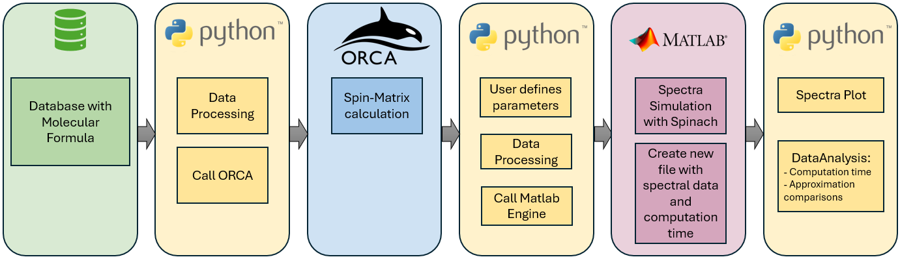
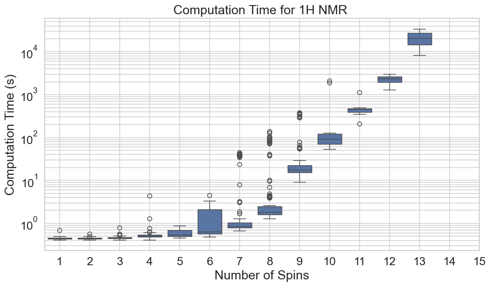
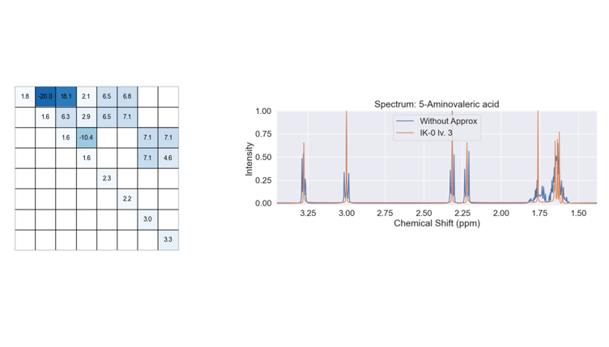

# Spectra Simulator

This project contains scripts designed to interface Python with Orca and MATLAB to automate NMR Simulations.
Additionally, there are some Jupyter Notebooks to help with the preprocessing data and analyse your results.



## Achieved Results

Computation times were measured for molecules with varying numbers of hydrogen atoms, and different approximations available in Spinach were evaluated for their suitability. 
Results showed that the time required to simulate 1H-NMR spectra increases super-exponentially with the number of hydrogen atoms, quickly exceeding the capabilities of classical computing for larger systems.


Although certain approximations significantly reduced computation time, allowing molecules with up to 31 hydrogen atoms to be simulated in under three seconds, they also led to information loss, making them less suitable for accurate machine learning training. 
Exemplary simulated spectra (right) with it's spin-matrix (left):



Therefore, to enable large-scale, high-fidelity NMR simulations, a promising next step is to perform these calculations on a quantum computer.


---

## 🚀 Getting Started

Follow these step-by-step instructions to set up the project on your **local machine**. These instructions assume minimal programming experience.

---

### 1. 🧪 Fork and Download the Repository

#### Step-by-step:
1. Go to the top-right corner of the [GitHub project page](https://github.com/your-repo-url) and click **"Fork"**.
2. After forking, click the green **"Code"** button on your forked repo, then select **"HTTPS"**.
3. Copy the link shown (e.g., `https://github.com/your-username/spinach-automation.git`).
4. On your computer, open a folder where you want to download the project.
5. Right-click and choose **"Open in Terminal"** or use your terminal/command prompt.
6. Run the following command:

```bash
git clone https://github.com/your-username/spinach-automation.git
```

7. Enter the new folder:
```bash
cd spinach-automation
```
### 2. Open the Project in an IDE
We recommend using PyCharm, VS Code, or Spyder.

1. Open your IDE.
2. Choose "Open Project" or "Open Folder" and select the cloned spinach-automation folder.

### 3. Set Up Python 3.11 Virtual Environment
If necessary Download Python 3.11 from the [https://www.python.org/downloads/windows/](python download page) and execute the installer:


Inside your IDE or terminal, create a virtual environment using Python 3.11.
In terminal (Windows):
```bash
python -m venv venv
venv\Scripts\activate
```
Or use the built-in virtual environment manager in your IDE and select Python 3.11.

### 4. Install Required Python Packages

Once the virtual environment is activated, install the required packages using pip:
```bash
pip install matlabengine==24.2.2
pip install matlab
pip install pandas
pip install json5
```
### 5. Install MATLAB 2024b
MATLAB 2024b must be installed and licensed properly to run this project.
For running the MATLAB library Spinach, you need to license and install following Toolboxes for MATLAB:
* Parallel Computing Toolbox
* Optimization Toolbox
* Deep Learning Toolbox
* Reinforcement Learning Toolbox
* Statistics and Machine Learning Toolbox
* Mapping Toolbox

[Follow MATLAB Online Installation Guide](https://ch.mathworks.com/help/install/install-products.html)

Make sure to install MATLAB 2024b and have it accessible in your system PATH.

Other versions than 2024b are not tested, but it should work if you install the correct engine and python version. You can look up the compatible Python Versions the [MathWorks Page](https://ch.mathworks.com/support/requirements/python-compatibility.html).
The table might be a bit confusing but here are some tips:
- the Release column contains the Matlab version
- MatlabEngine Version: the naming rule is: YY.release.version eg. 2025a = matlabengine 25.1.1 or 25.1.2 and 2025b = 25.2.1 or 25.2.2 ([here](https://pypi.org/project/matlabengine/24.1.4/#history) you can find the newest engine version)
- the column MATLAB Interface / MATLAB Engine contains the compatible Python version

### 6. Set Up Spinach

Spinach is a MATLAB library for spin dynamics simulation. You can download the latest Version on the
[SpinDynamics.org page](https://spindynamics.org/?page_id=12)
(safe Version: 2.9.2) and follow the
[Spinach Setup Guide](https://spindynamics.org/wiki/index.php?title=Installation)

### 7. Install ORCA (Quantum Chemistry Engine)
Coming Soon...

### 8. Import your Dataset
If you use the gissmo_spin_matrix.csv you can save it under data\gissmo_spin_matrix.csv and scip the rest of this part.

The standard filepath is data\gissmo_spin_matrix.csv.
There is a helper function that converts the gissmo_spin_matrix.csv in the expected format and saves it under data\temp_dataset.csv.
**Important**:
The MATLAB Script always takes as input data\temp_dataset.csv so if you have a different dataset you have to save it there 
or change the path in the MATLAB Script (spectra_simulator\spectra_simulator.m).
The data\temp_dataset.csv needs to be structured as followed:
columns: Name, FieldStrength, spin_matrix, n_spins

| column        | specification                               | example                                         |
|---------------|---------------------------------------------|-------------------------------------------------|
| Name          | string                                      | Cuminaldehyde                                   |
| FieldStrength | float in Tesla                              | 499.84                                          |
| spin_matrix   | lists of floats delimited with a semi-colon | "[1. 0. 0.];<br/> [0. 4. 0.];<br/> [0. 0. 2.4]" |
| n_spins       | Integer, representing the number of spins   | 9                                               |


(here will be further specifications as soon, there we have the ORRCA code)

### 9. Run the Code in the IDE
1. Open the main Python script (spectraSimulator.py) in you IDE.
2. Make sure your virtual environment is selected.
3. Press Run or use the IDE's Run Script option.

Your Run Terminal will open and ask you if you want to setup matlab engine. If you followed the described Setup that's already done and you can type "n".
Now you have to specify your parameters, you can type the listed name of the parameter and press Enter to change it. After entering the new value you can press
Enter again and choose another parameter to change or type "done" to start the calculations.
filename: where your unprocesses dataset is stored. helper.clean_csv.py will take that file and generate the temp_dataset.
approx: Approximation; Possible inputs: none; IK-0, IK-1, IK-2
approx_level: level of approximation; see [5 Formalism and Basis set Specification](https://analyticalsciencejournals.onlinelibrary.wiley.com/doi/10.1002/mrc.4660?utm_source=chatgpt.com)
windowSize: has a flaw, leave as it is
offset_ppm: has a flaw, leave as it is
npoints: Integer value; more points give a higher resolution of the spectra
x: number of molecules that will be calculated; Possible inputs: 'all' or integer from 1 to len(dataset)


## Plot Spectra
Open the DataAnalysis directory and then the Jupyter Notebook called **`0_Plot_Spectra.ipynb`**. 
Insert the Filename of your created Spectra and the name of the molecule you want to inspect.


## Computation Time Analysis

The Jupyter Notebook **`1_ComputationTime_analysis.ipynb`** allows you to analyze how long it took to simulate your molecules.

To begin:
- Insert the filename containing your simulation results.
- If you haven't changed the default filename after running the workflow, the notebook will automatically detect the metadata file.
- If you **did** change the filename, open the `get_df_and_data()` function and manually specify the new metadata filename.

This analysis reveals how the number of **spins** and **J-couplings** affects computation time.

The notebook also includes two approaches for estimating computation time for larger molecules:
1. A model that solely assumes exponential impact of the **number of spins** on computation time.
2. A model that estimates the number of **J-couplings** based on the number of spins and assumes an **exponential impact** of J-couplings on computation time.

---

## Approximation Analysis

The Jupyter Notebook **`2_Approximation_analysis.ipynb`** compares simulations using different approximation methods against simulations without any approximation.

**Important Notes:**
- Only molecules that were successfully computed **both with and without** approximations are included in the comparison.
- Molecules that are too large to compute without approximation, or too small for the approximation to apply, will be excluded.

The notebook compares the following metrics:
- Computation time
- Sum of distances
- Cosine similarity
- Number of peaks (based on the specific peak-picking algorithm)

At the end of the notebook, you can also **plot the spectra** to visually analyze the differences between methods.

I recommend to run the code in the "peak comparison" section, identify the molecule with interesting differences and plot them by providing the index extracted from the peak comparison plots.
---

## Enamine

The Jupyter Notebook **`3_Enamine.ipynb`** provides an estimate of computation times for large datasets—such as the **Enamine database**—based on your previous computation results.

---

## z_Create_files.ipynb

This notebook helps you create a **subset of your dataset**.

**Prerequisites:**
- The input must be a `.csv` file.
- The file should include either:
  - A column named `Index` containing lists like `[2, 5, 6, 11, 19]` (indicating 5 spins), or
  - A column named `n_spins` that directly provides the number of spins.

  
  
## Authors and acknowledgment
I would like to express my sincere gratitude to my supervisor, Prof. Clément Javerzac, for his invaluable guidance in introducing me to the field of quantum mechanics. His insightful advice in interpreting my results and their support in welcoming me into an inspiring research group working on cutting-edge developments in quantum topics have been instrumental to this thesis and are the reason for my ongoing interest in quantum mechanics. 

I am also deeply thankful to Artemiy Burov for providing me with essential literature to get started in this complex topic and for suggesting the practical tools that were needed for spectra simulation. I appreciate the time and commitment both of them devoted each week to discuss my progress and guide the next steps of this work.
